# 三维资产库

按载体类别归档的离线三维模型，全部为可直接加载的 OBJ（Z 轴向上、原点在底面中心、
机身/车头朝 +X），尺寸按真实量级归一，三角面数抽稀到 3 000 左右，供 `simkit`
场景直接引用：

```json
{"shape": "obj", "model": "../assets/models/军舰/战列舰.obj", "height": 30}
```

总计 **52** 个模型，9 个类别，合计 19.8 MB。
许可构成：CC0 13 个（可商用、免署名），CC-BY 39 个（需署名，见下表与 [`../CREDITS.md`](../CREDITS.md)）。

**每个 `.obj` 旁边都有一张同名 `.png` 预览图**（512×384，白底），不用打开建模软件
就能看清模型长什么样；下面每个类别还附一张带名称和尺寸的总览图（`sheets/`）。

## 怎么打开 OBJ

| 方式 | 说明 |
|---|---|
| 直接看 PNG | 每个模型旁的同名 `.png`，先确认是不是想要的模型 |
| Windows「3D 查看器」 | 双击 `.obj` 即可，Win10/11 自带，可旋转缩放 |
| Blender | `third_party/blender/blender.exe`，`文件 > 导入 > Wavefront (.obj)`，可编辑 |
| MeshLab | 适合查看面数、法线、做清理，开源免费 |
| Python | `from simkit.mesh import load_obj; m = load_obj('...obj')` |

> 注意：本库的 OBJ 只保留几何、不带贴图材质，所以其它软件里显示为素色，这是
> 预期行为——仿真只用到几何与尺寸。

## 目录

- [旋翼无人机](#旋翼无人机)（6）
- [固定翼无人机](#固定翼无人机)（1）
- [直升机](#直升机)（4）
- [民航飞机](#民航飞机)（5）
- [军用飞机](#军用飞机)（5）
- [地面车辆](#地面车辆)（10）
- [军用地面车辆](#军用地面车辆)（7）
- [军舰](#军舰)（5）
- [民用船舶](#民用船舶)（9）

## 旋翼无人机

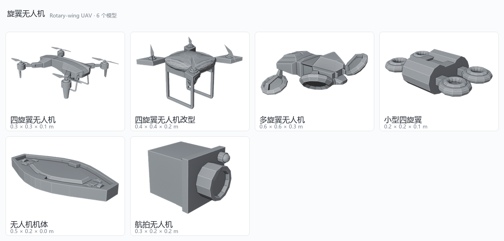

| 预览 | 中文名称 | 文件 | 尺寸 长×宽×高 (m) | 面数 | 许可 | 作者 | 来源 |
|---|---|---|---|---|---|---|---|
| 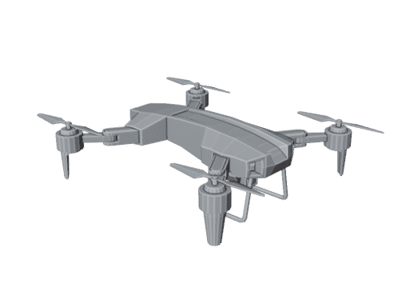 | 四旋翼无人机 | `四旋翼无人机.obj` | 0.3 × 0.3 × 0.1 | 3,500 | CC-BY | NateGazzard | [原页](https://poly.pizza/m/DNbUoMtG3H) |
| 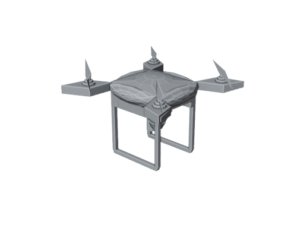 | 四旋翼无人机改型 | `四旋翼无人机改型.obj` | 0.4 × 0.4 × 0.2 | 2,397 | CC-BY | Silly Fear | [原页](https://poly.pizza/m/3Ae_y67lzvd) |
| 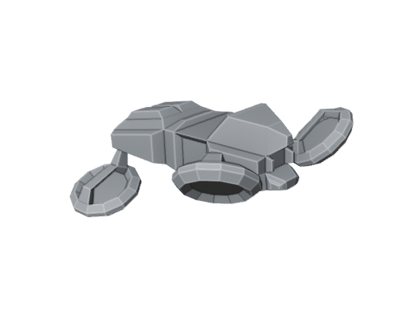 | 多旋翼无人机 | `多旋翼无人机.obj` | 0.6 × 0.6 × 0.3 | 1,132 | CC-BY | Aaron Clifford | [原页](https://poly.pizza/m/6CUQX98vha4) |
| 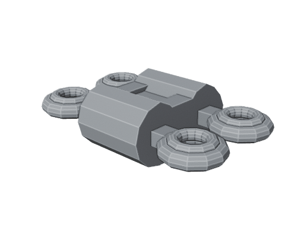 | 小型四旋翼 | `小型四旋翼.obj` | 0.2 × 0.2 × 0.1 | 2,690 | CC-BY | Nick Olson | [原页](https://poly.pizza/m/dJ9mjQQqDQJ) |
| 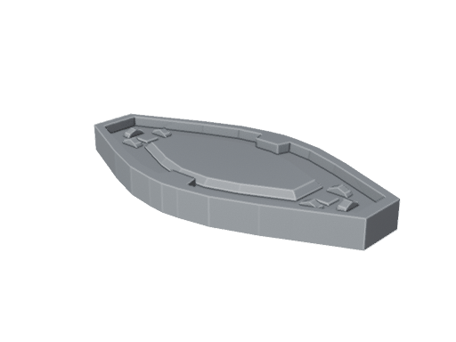 | 无人机机体 | `无人机机体.obj` | 0.5 × 0.2 × 0.0 | 864 | CC-BY | Poly by Google | [原页](https://poly.pizza/m/dCOUTcu89u6) |
| 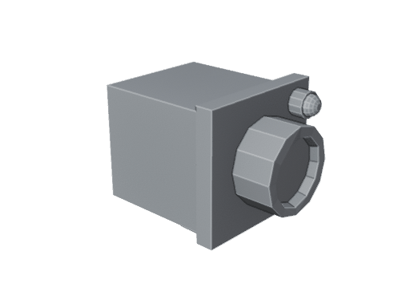 | 航拍无人机 | `航拍无人机.obj` | 0.3 × 0.2 × 0.2 | 1,830 | CC-BY | Christopher Burgess (ChrispyBurgers) | [原页](https://poly.pizza/m/fyB_cRYLcUY) |

## 固定翼无人机

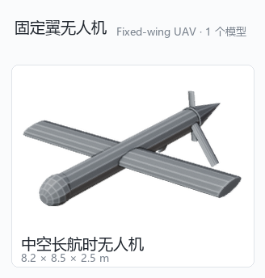

| 预览 | 中文名称 | 文件 | 尺寸 长×宽×高 (m) | 面数 | 许可 | 作者 | 来源 |
|---|---|---|---|---|---|---|---|
| 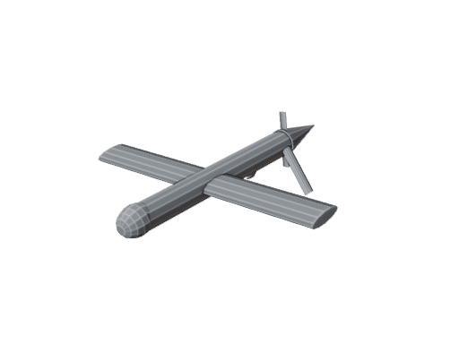 | 中空长航时无人机 | `中空长航时无人机.obj` | 8.2 × 8.5 × 2.5 | 434 | CC-BY | sftwr314r8 | [原页](https://poly.pizza/m/3Eio09miiAF) |

## 直升机

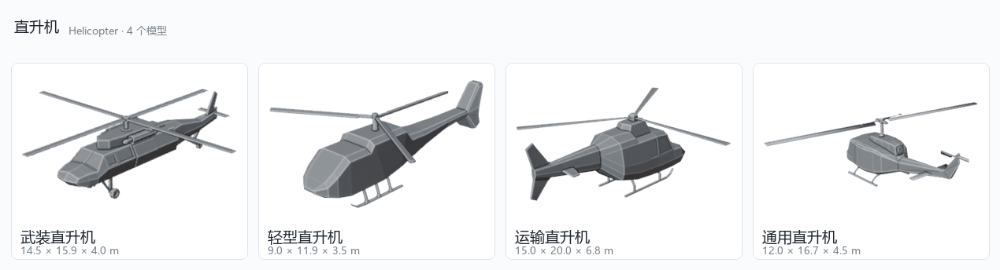

| 预览 | 中文名称 | 文件 | 尺寸 长×宽×高 (m) | 面数 | 许可 | 作者 | 来源 |
|---|---|---|---|---|---|---|---|
| 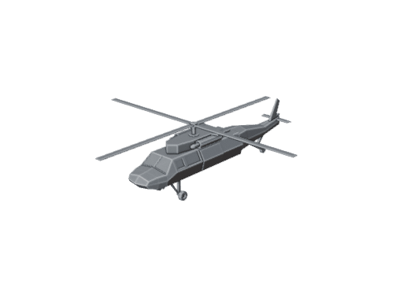 | 武装直升机 | `武装直升机.obj` | 14.5 × 15.9 × 4.0 | 1,088 | CC-BY | Zsky | [原页](https://poly.pizza/m/hG2Qr0A3zR) |
| 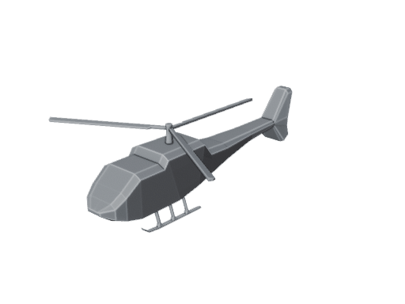 | 轻型直升机 | `轻型直升机.obj` | 9.0 × 11.9 × 3.5 | 1,094 | CC0 | kazuma | [原页](https://poly.pizza/m/EQJ2MECUbx) |
| 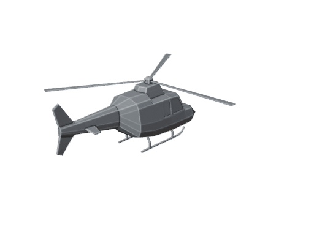 | 运输直升机 | `运输直升机.obj` | 15.0 × 20.0 × 6.8 | 840 | CC-BY | jeremy | [原页](https://poly.pizza/m/eb7b31pjGtQ) |
| 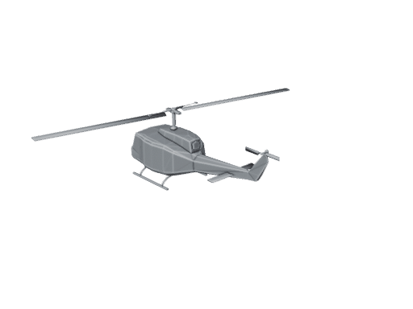 | 通用直升机 | `通用直升机.obj` | 12.0 × 16.7 × 4.5 | 1,041 | CC-BY | Poly by Google | [原页](https://poly.pizza/m/cTzINMr0WdS) |

## 民航飞机

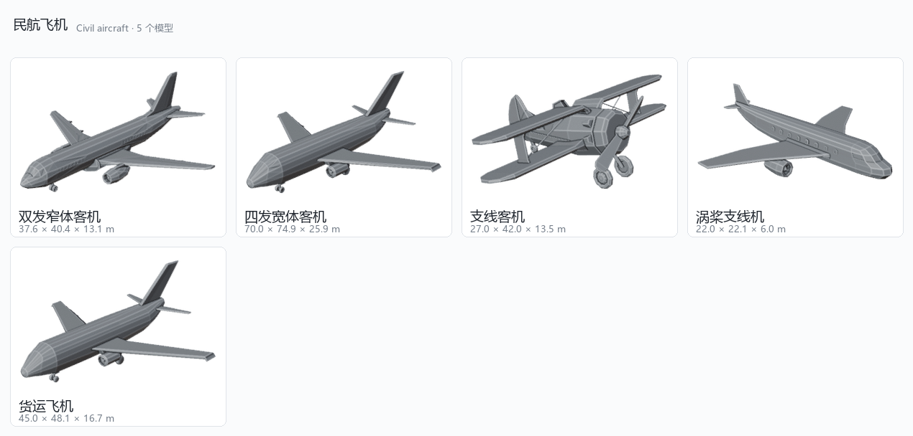

| 预览 | 中文名称 | 文件 | 尺寸 长×宽×高 (m) | 面数 | 许可 | 作者 | 来源 |
|---|---|---|---|---|---|---|---|
| 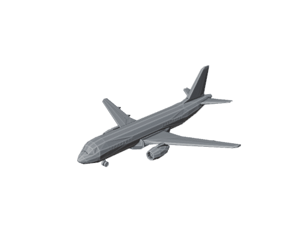 | 双发窄体客机 | `双发窄体客机.obj` | 37.6 × 40.4 × 13.1 | 3,500 | CC-BY | Poly by Google | [原页](https://poly.pizza/m/a3XrQkLNna9) |
| 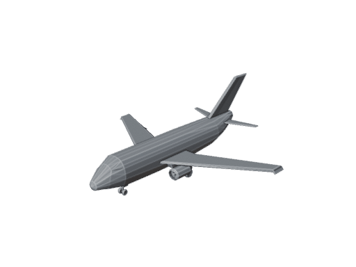 | 四发宽体客机 | `四发宽体客机.obj` | 70.0 × 74.9 × 25.9 | 1,772 | CC-BY | Poly by Google | [原页](https://poly.pizza/m/8ciDd9k8wha) |
| 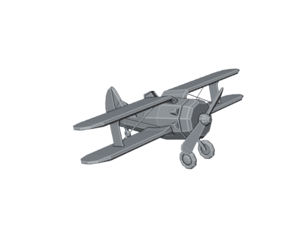 | 支线客机 | `支线客机.obj` | 27.0 × 42.0 × 13.5 | 1,770 | CC-BY | Poly by Google | [原页](https://poly.pizza/m/8VysVKMXN2J) |
| 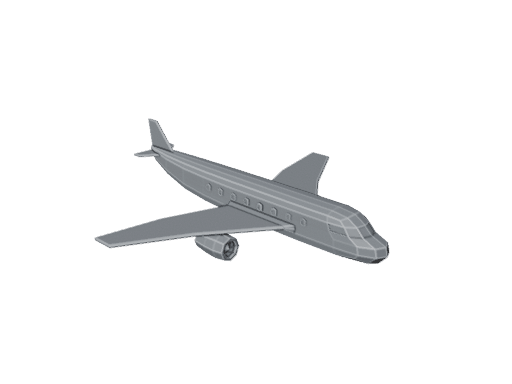 | 涡桨支线机 | `涡桨支线机.obj` | 22.0 × 22.1 × 6.0 | 1,886 | CC-BY | jeremy | [原页](https://poly.pizza/m/9Ev6pklkSYp) |
| 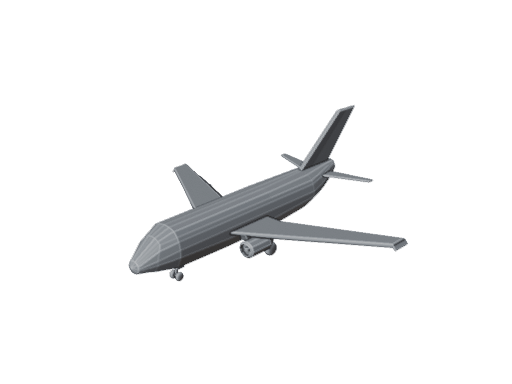 | 货运飞机 | `货运飞机.obj` | 45.0 × 48.1 × 16.7 | 1,426 | CC-BY | Poly by Google | [原页](https://poly.pizza/m/2eG17I-VDiG) |

## 军用飞机

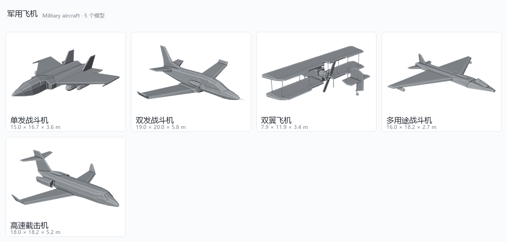

| 预览 | 中文名称 | 文件 | 尺寸 长×宽×高 (m) | 面数 | 许可 | 作者 | 来源 |
|---|---|---|---|---|---|---|---|
| 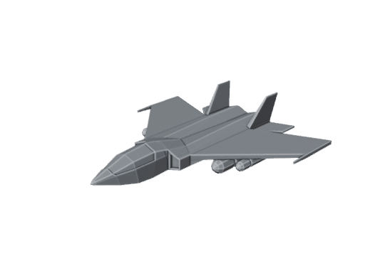 | 单发战斗机 | `单发战斗机.obj` | 15.0 × 16.7 × 3.6 | 1,434 | CC-BY | jeremy | [原页](https://poly.pizza/m/6fyLMORhgGK) |
| 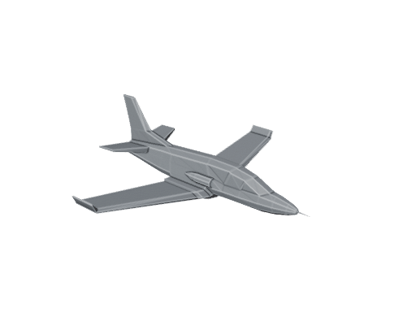 | 双发战斗机 | `双发战斗机.obj` | 19.0 × 20.0 × 5.8 | 928 | CC-BY | Poly by Google | [原页](https://poly.pizza/m/3B3Pa6BHXn1) |
| 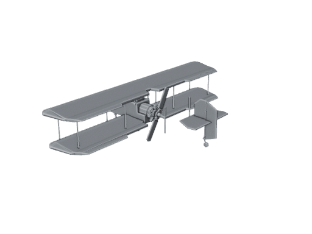 | 双翼飞机 | `双翼飞机.obj` | 7.9 × 11.9 × 3.4 | 3,499 | CC-BY | Joshua Johanson | [原页](https://poly.pizza/m/9iVI9GHMleJ) |
| 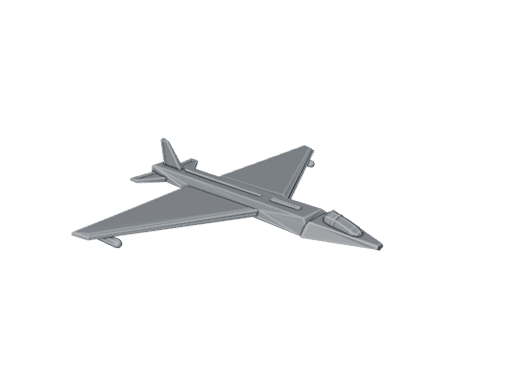 | 多用途战斗机 | `多用途战斗机.obj` | 16.0 × 18.2 × 2.7 | 1,512 | CC-BY | Poly by Google | [原页](https://poly.pizza/m/dukcCKsLDrS) |
| 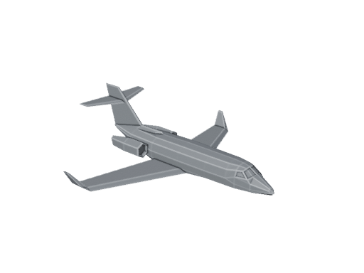 | 高速截击机 | `高速截击机.obj` | 18.0 × 18.2 × 5.2 | 618 | CC-BY | Poly by Google | [原页](https://poly.pizza/m/bgUY8zN2Bq9) |

## 地面车辆

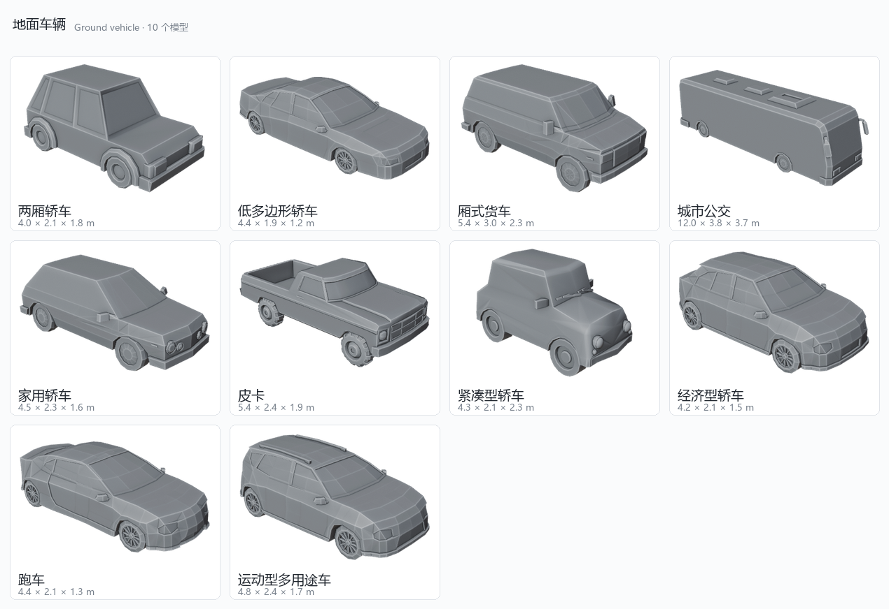

| 预览 | 中文名称 | 文件 | 尺寸 长×宽×高 (m) | 面数 | 许可 | 作者 | 来源 |
|---|---|---|---|---|---|---|---|
| 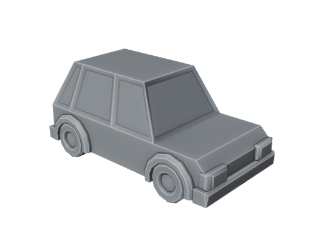 | 两厢轿车 | `两厢轿车.obj` | 4.0 × 2.1 × 1.8 | 1,194 | CC0 | Kay Lousberg | [原页](https://poly.pizza/m/BG0KAhmGDt) |
| 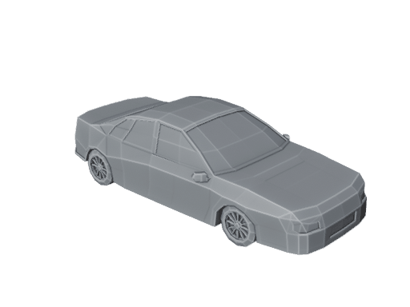 | 低多边形轿车 | `低多边形轿车.obj` | 4.4 × 1.9 × 1.2 | 2,954 | CC0 | Quaternius | [原页](https://poly.pizza/m/Cz6yDaUcM9) |
| 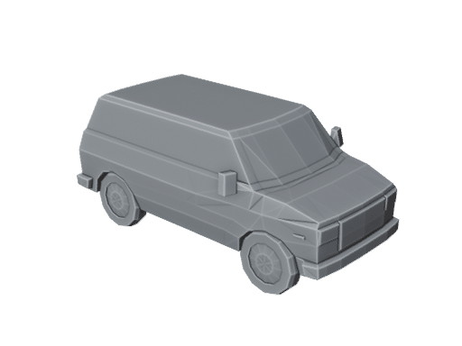 | 厢式货车 | `厢式货车.obj` | 5.4 × 3.0 × 2.3 | 1,946 | CC-BY | Poly by Google | [原页](https://poly.pizza/m/aT_24cDaW1a) |
| 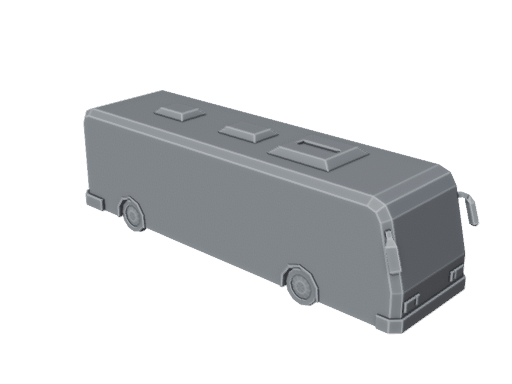 | 城市公交 | `城市公交.obj` | 12.0 × 3.8 × 3.7 | 2,226 | CC-BY | Poly by Google | [原页](https://poly.pizza/m/4CPpvEmrMoF) |
| 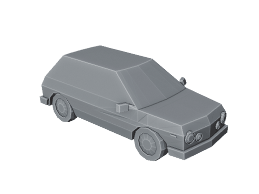 | 家用轿车 | `家用轿车.obj` | 4.5 × 2.3 × 1.6 | 2,050 | CC-BY | Poly by Google | [原页](https://poly.pizza/m/75h3mi6uHuC) |
| 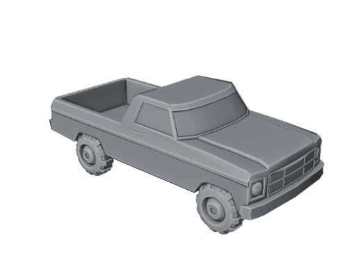 | 皮卡 | `皮卡.obj` | 5.4 × 2.4 × 1.9 | 3,500 | CC0 | Quaternius | [原页](https://poly.pizza/m/qn4grQgHm8) |
| 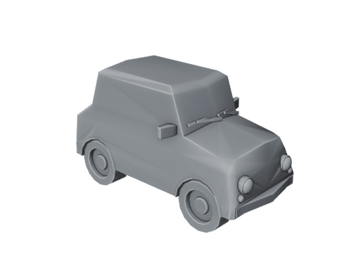 | 紧凑型轿车 | `紧凑型轿车.obj` | 4.3 × 2.1 × 2.3 | 2,944 | CC-BY | Poly by Google | [原页](https://poly.pizza/m/eRu2kPYOCa7) |
| 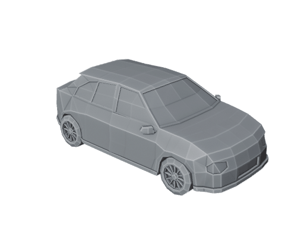 | 经济型轿车 | `经济型轿车.obj` | 4.2 × 2.1 × 1.5 | 3,124 | CC0 | Quaternius | [原页](https://poly.pizza/m/unqqkULtRU) |
| 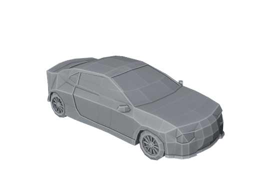 | 跑车 | `跑车.obj` | 4.4 × 2.1 × 1.3 | 3,148 | CC0 | Quaternius | [原页](https://poly.pizza/m/1mkmFkAz5v) |
| 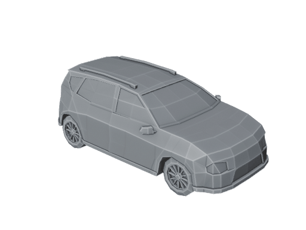 | 运动型多用途车 | `运动型多用途车.obj` | 4.8 × 2.4 × 1.7 | 3,294 | CC0 | Quaternius | [原页](https://poly.pizza/m/xsMtZhBkxL) |

## 军用地面车辆

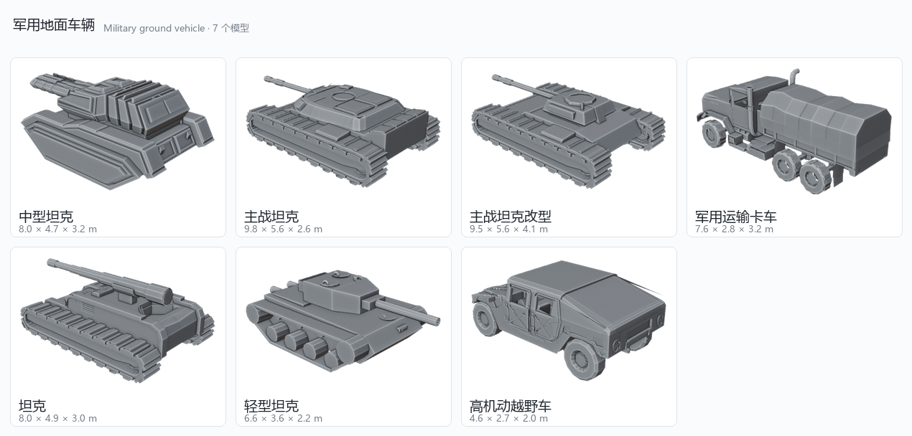

| 预览 | 中文名称 | 文件 | 尺寸 长×宽×高 (m) | 面数 | 许可 | 作者 | 来源 |
|---|---|---|---|---|---|---|---|
| 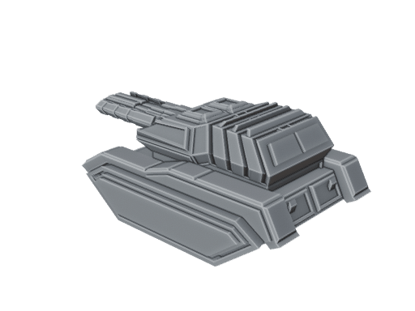 | 中型坦克 | `中型坦克.obj` | 8.0 × 4.7 × 3.2 | 2,786 | CC-BY | Zayn | [原页](https://poly.pizza/m/YWSyTmvGI2) |
| 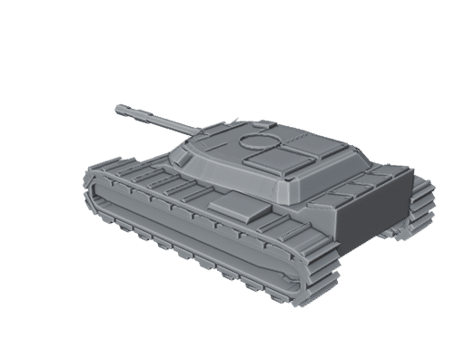 | 主战坦克 | `主战坦克.obj` | 9.8 × 5.6 × 2.6 | 3,500 | CC0 | Quaternius | [原页](https://poly.pizza/m/FA5daiyZQq) |
| 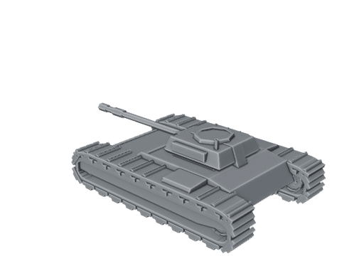 | 主战坦克改型 | `主战坦克改型.obj` | 9.5 × 5.6 × 4.1 | 3,500 | CC0 | Quaternius | [原页](https://poly.pizza/m/jWS1CLA0RO) |
| 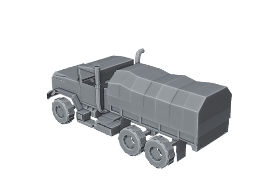 | 军用运输卡车 | `军用运输卡车.obj` | 7.6 × 2.8 × 3.2 | 3,500 | CC-BY | J-Toastie | [原页](https://poly.pizza/m/y8lBpvMlim) |
| 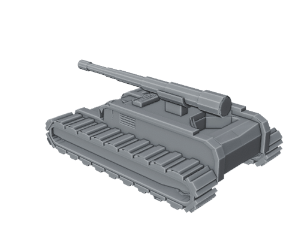 | 坦克 | `坦克.obj` | 8.0 × 4.9 × 3.0 | 3,500 | CC0 | Quaternius | [原页](https://poly.pizza/m/uYHpj7lz1J) |
| 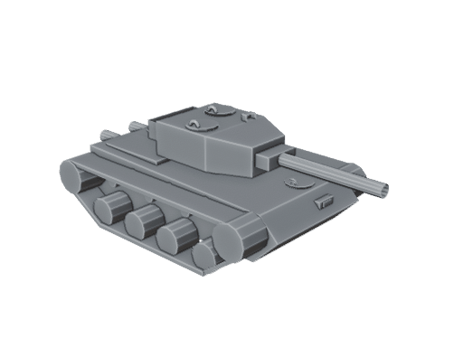 | 轻型坦克 | `轻型坦克.obj` | 6.6 × 3.6 × 2.2 | 3,500 | CC-BY | Nico _ | [原页](https://poly.pizza/m/41Tq_Kf0Tui) |
| 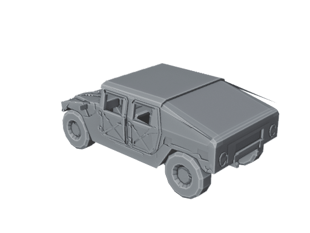 | 高机动越野车 | `高机动越野车.obj` | 4.6 × 2.7 × 2.0 | 3,500 | CC-BY | madtrollstudio | [原页](https://poly.pizza/m/Ebryot9iKM) |

## 军舰

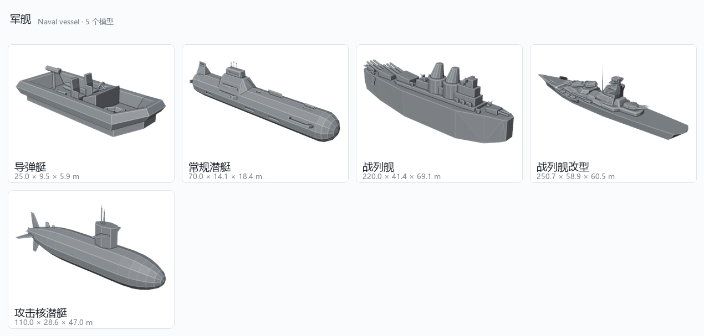

| 预览 | 中文名称 | 文件 | 尺寸 长×宽×高 (m) | 面数 | 许可 | 作者 | 来源 |
|---|---|---|---|---|---|---|---|
| 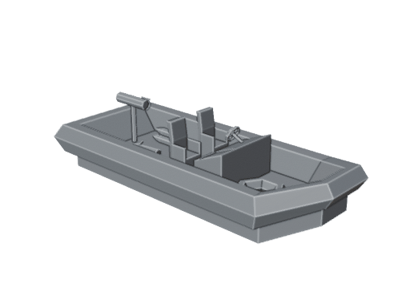 | 导弹艇 | `导弹艇.obj` | 25.0 × 9.5 × 5.9 | 868 | CC-BY | Zsky | [原页](https://poly.pizza/m/wouBxOe3CD) |
| 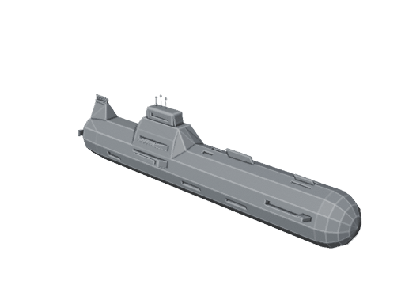 | 常规潜艇 | `常规潜艇.obj` | 70.0 × 14.1 × 18.4 | 2,088 | CC-BY | Poly by Google | [原页](https://poly.pizza/m/8PgPdFGg3MO) |
| 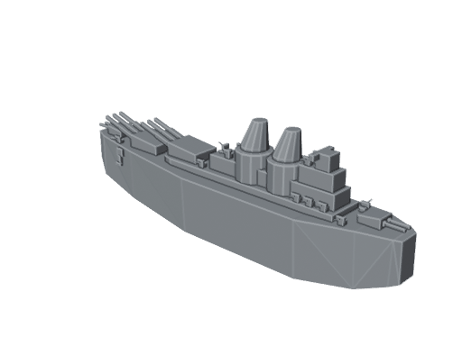 | 战列舰 | `战列舰.obj` | 220.0 × 41.4 × 69.1 | 2,432 | CC-BY | Thomas de Rivaz | [原页](https://poly.pizza/m/aYAmfkUYZjg) |
| 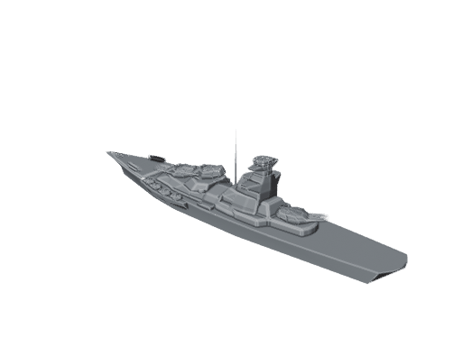 | 战列舰改型 | `战列舰改型.obj` | 250.7 × 58.9 × 60.5 | 3,500 | CC-BY | angelo raffaele Catalano | [原页](https://poly.pizza/m/cqV6mUkn7Ow) |
|  | 攻击核潜艇 | `攻击核潜艇.obj` | 110.0 × 28.6 × 47.0 | 1,348 | CC-BY | Poly by Google | [原页](https://poly.pizza/m/dfSQmeuuYt3) |

## 民用船舶


| 预览 | 中文名称 | 文件 | 尺寸 长×宽×高 (m) | 面数 | 许可 | 作者 | 来源 |
|---|---|---|---|---|---|---|---|
|  | 大型游轮 | `大型游轮.obj` | 260.0 × 63.6 × 74.1 | 1,044 | CC-BY | jeremy | [原页](https://poly.pizza/m/aOikPp4rz68) |
|  | 小型渔船 | `小型渔船.obj` | 15.0 × 7.8 × 3.3 | 224 | CC0 | Quaternius | [原页](https://poly.pizza/m/5UEl54KsuC) |
|  | 帆船 | `帆船.obj` | 12.0 × 7.2 × 9.6 | 752 | CC-BY | Poly by Google | [原页](https://poly.pizza/m/6okvxHsSdzO) |
|  | 游艇 | `游艇.obj` | 28.0 × 6.0 × 8.6 | 1,206 | CC-BY | Alex Safayan | [原页](https://poly.pizza/m/9znU2c-dTSR) |
|  | 游轮 | `游轮.obj` | 240.0 × 59.6 × 64.1 | 3,500 | CC-BY | Poly by Google | [原页](https://poly.pizza/m/dgLCxDWhnZQ) |
|  | 豪华游轮 | `豪华游轮.obj` | 300.0 × 66.5 × 109.7 | 858 | CC0 | Quaternius | [原页](https://poly.pizza/m/yq9EKmEmfC) |
|  | 远洋帆船 | `远洋帆船.obj` | 45.0 × 12.0 × 27.2 | 3,500 | CC0 | Quaternius | [原页](https://poly.pizza/m/cIzO4MBPqI) |
|  | 远洋邮轮 | `远洋邮轮.obj` | 269.0 × 31.5 × 64.1 | 6,446 | CC-BY | LEDEGENERE | [原页](https://poly.pizza/m/2vKA7JD0JU) |
|  | 集装箱船 | `集装箱船.obj` | 200.0 × 43.1 × 78.2 | 1,620 | CC-BY | Alex Safayan | [原页](https://poly.pizza/m/3AmDGcCu6Ll) |

## 处理流程

1. `tools/fetch_vehicle_models.py` 依清单从 Poly Pizza 下载原始 GLB；
2. `tools/prepare_vehicles.blender.py` 用 Blender 无头导入，按真实车长/舰长/机身长
   归一，Z 轴向上、机头朝 +X，抽稀到约 3 500 三角面，落地到 z=0；
3. `tools/render_model_previews.py` 为每个模型渲染右侧的三分之四视角预览图；
4. `tools/make_model_sheets.py` 生成分类总览图；
5. 元数据汇总到 [`catalog.json`](catalog.json)。

原始 GLB 与中间文件不入库（`assets/_cache/` 已忽略），可按脚本重跑复现。尺寸为按
真实型号量级设定的声明值，用于仿真而非测绘级还原。
